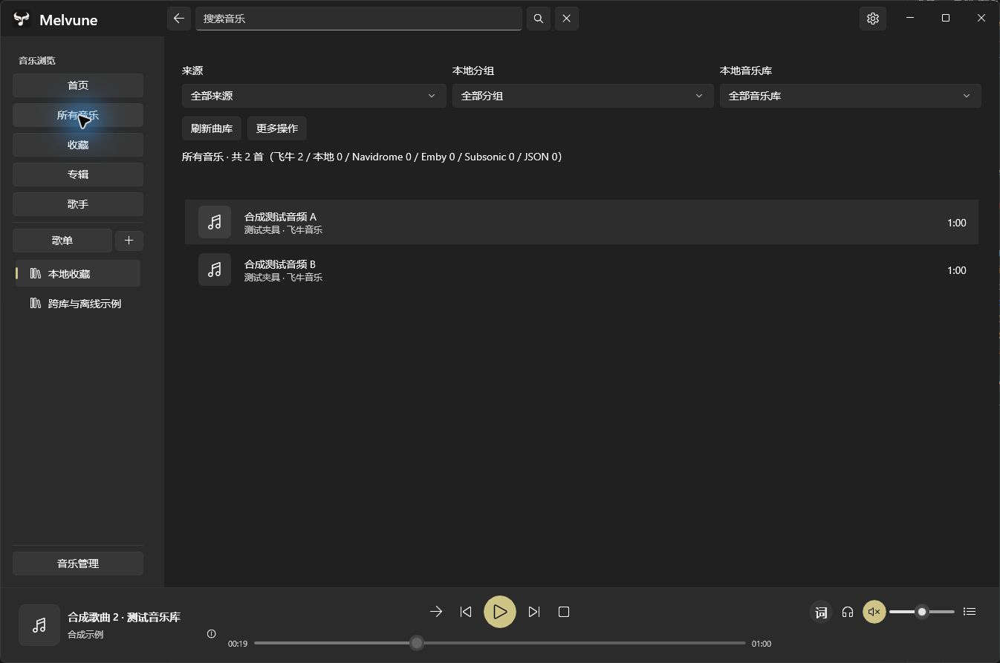
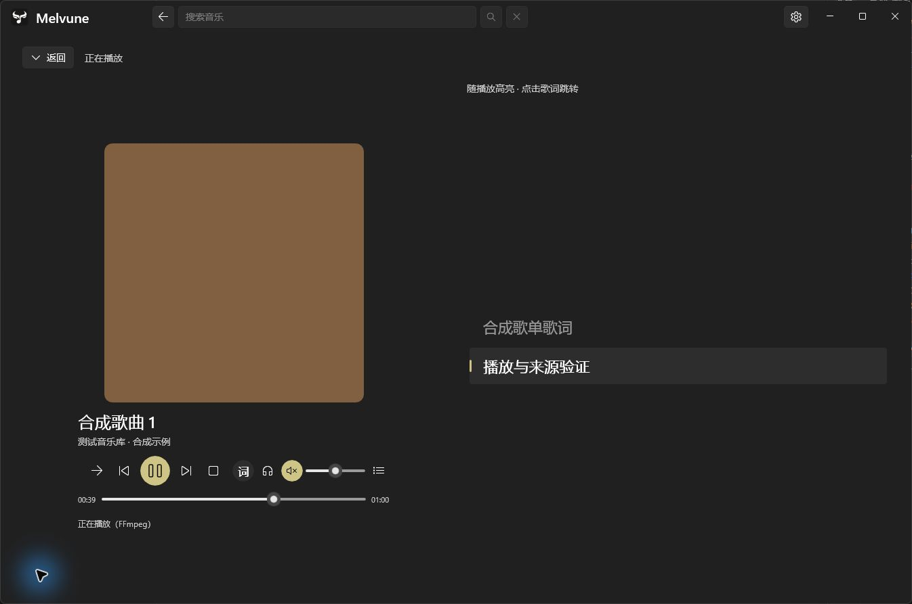

<p align="center"></p>
<h1 align="center">Melvune · 合听</h1>
<p align="center">把自己的音乐，放在一起听。</p>
<p align="center">Windows 原生多来源音乐播放器 · WinUI 3 · 本地音乐与个人音乐服务器</p>
<p align="center">
  <a href="https://github.com/JuuWaii/Melvune/releases/tag/v0.2.0-rc.9">下载候选版</a> ·
  <a href="docs/USER_GUIDE.md">使用指南</a> · <a href="docs/README.md">文档</a> ·
  <a href="https://github.com/JuuWaii/Melvune/issues">反馈问题</a>
</p>

## 项目简介

Melvune（合听）是一款面向 Windows 的开源音乐播放器。它把本地文件、飞牛音乐以及多种个人音乐服务器接入同一套音乐库、播放队列和本地歌单，让分散收藏的音乐更容易浏览与播放。

应用使用 C#、WinUI 3 与 FFmpeg 构建，以黑白界面为主，支持浅色、深色和跟随系统主题。Melvune 从原飞牛音乐 Windows 客户端发展而来，现作为独立的多来源播放器继续开发。

## 快速下载

**当前候选版本：0.2.0-rc.9，已发布。** 支持 Windows 10 2004（19041）及以上 **x64** 系统。

| 下载 | 如何使用 |
| --- | --- |
| [安装 EXE](https://github.com/JuuWaii/Melvune/releases/download/v0.2.0-rc.9/Melvune-0.2.0-rc.9-win-x64-setup.exe) | 常规安装入口，Options / Browse 选择可写目录 |
| [安装 MSI](https://github.com/JuuWaii/Melvune/releases/download/v0.2.0-rc.9/Melvune-0.2.0-rc.9-win-x64-setup.msi) | 中文目录选择页，与安装 EXE 选择一种即可 |
| [便携 EXE](https://github.com/JuuWaii/Melvune/releases/download/v0.2.0-rc.9/Melvune-0.2.0-rc.9-win-x64-portable.exe) | 放在可写目录运行；首次校验并解包到旁边的 `Melvune-portable`，配置保存在其 `Data` 目录 |
| [完整 ZIP](https://github.com/JuuWaii/Melvune/releases/download/v0.2.0-rc.9/Melvune-0.2.0-rc.9-win-x64.zip) | 完整解压，运行 `Start-Melvune.cmd` 或 `Melvune.App.exe` |
| [Release 与校验和](https://github.com/JuuWaii/Melvune/releases/tag/v0.2.0-rc.9) | 查看更新说明、`SHA256SUMS.txt` 和构建来源 `release.json` |

运行时与解码依赖随包提供，无需另装 .NET 或 FFmpeg。此版本为**未签名的预发布候选版**，代码签名和自动更新尚未提供。请从本仓库 Release 下载，以该次云端构建附带的校验和为准。[rc.9交付回执](docs/RC9_PUBLICATION.md)记录构建、安装验收和附件摘要。

> 改名前版本的配置不会自动迁入 Melvune。新版需要重新添加音乐源、登录和建立歌单；旧配置不会被覆盖。普通 ZIP 的配置在 `%LOCALAPPDATA%\Melvune.Native`，与便携版独立。详见 [配置与命名说明](docs/MELVUNE_MIGRATION.md)。

## 界面预览

以下为当前 WinUI 界面的合成数据演示，不包含真实账号、私人曲库或音乐作品封面。

<details open>
<summary>音乐库与播放栏 · 深色主题</summary>



</details>

<details>
<summary>应用内歌词与播放控制</summary>



</details>

## 核心能力

| 场景 | 当前支持 |
| --- | --- |
| 本地音乐 | 多音乐库与分组、后台扫描、持久索引；重新启动先恢复已扫描目录，再检查变化 |
| 个人音乐服务器 | 飞牛音乐、Navidrome、Emby、Subsonic 兼容源，以及匿名同源 HTTP/JSON 音乐源 |
| 歌单 | 跨音乐库本地歌单；当前账号的飞牛同步歌单，可在侧栏合并或按来源分类 |
| 播放 | 队列、下一曲、顺序/随机/循环、音量与输出设备选择；正常退出后保存队列和进度，重启点击播放继续 |
| 封面与歌词 | 歌曲/专辑封面、受支持的内嵌和外部歌词、应用内歌词页、右侧队列抽屉 |
| 桌面联动 | SMTC 系统媒体控制、透明桌面歌词、锁定与鼠标穿透、托盘、可选全局快捷键和睡眠定时 |
| 音乐管理 | 本地库与服务连接管理；飞牛素材库和支持的非 UI 设置按服务端权限开放 |
| 扩展接口 | 可选的当前 Windows 用户只读播放信息与歌词接口，默认关闭，需第三方按协议适配 |

Navidrome、Emby 和 Subsonic 接入当前以**只读浏览和原始音频播放**为主，不写入其服务端歌单或收藏，不提供转码。HTTP/JSON 来源仅支持匿名同源访问，不执行脚本，也不支持认证头或跨域 CDN。各来源的能力与限制见 [使用指南](docs/USER_GUIDE.md)。

## 开始使用

1. 打开「音乐管理 → 音乐库」，添加本地目录或选择音乐服务器类型。
2. 本地音乐完成首次扫描后即可使用；连接服务器时填写服务地址和账号信息。
3. 双击歌曲播放，右键安排下一曲或加入歌单；点击左下角封面打开应用内歌词。
4. 播放栏右侧可打开桌面歌词、切换输出设备和查看播放队列；标题栏齿轮进入设置。

会话或凭据使用当前 Windows 用户的 DPAPI 加密保存，不保存明文密码。更换机器或 Windows 用户后需重新登录。音乐索引与歌单不包含音频副本，来源离线时无法开始播放其文件。

## 文档与开发

- [文档索引](docs/README.md)：使用、来源接入、桌面联动、构建和历史验收。
- [开发清单](docs/NEXT_DEVELOPMENT_CHECKLIST.md)：当前发布进度的统一入口。
- [rc.9 验收](docs/RC9_ACCEPTANCE.md) / [用户验证单](docs/RC9_USER_VALIDATION.md)：已验证范围和仍需真实环境验证的项目。
- [贡献指南](CONTRIBUTING.md)：构建、检查与反馈约定。

从源码构建需要 Windows x64、PowerShell 7.2+、Git、Python 3.11+ 和 Node.js。脚本会在 `.tools` 中准备固定版本的 SDK 与解码工具链。

```powershell
./scripts/native.ps1 bootstrap
./scripts/preview.ps1 -Run
./scripts/native.ps1 test
```

开发时仅按需要生成可运行 Debug 预览，不生成发行 ZIP 或安装器；最终发布推送时由标签工作流统一打包。预览位于 `dist/previews`，每日清理保留最近3份及7天内产物，历史发行包不受影响。

解决方案为 `native/Melvune.sln`。[封装说明](docs/WINDOWS_PACKAGING.md)介绍 ZIP 和便携 EXE；[发布流程](docs/RELEASING.md)说明 GitHub Actions 的构建、校验和发布步骤。

## 开发状态与限制

项目仍在持续开发。飞牛网页修改歌单后需刷新读取，不承诺实时推送或并发编辑事务；第三方服务版本、实体媒体键、全部 DPI/编码/设备热插拔及长期运行组合尚未全面验收。正常退出保存进度不等于崩溃或断电恢复。具体边界随版本记录，未实测项目不视为已通过。

认证式自定义来源、第三方服务端写入、转码、自动更新留待后续版本。欢迎在 [Issues](https://github.com/JuuWaii/Melvune/issues) 提供版本、复现步骤、预期与实际结果；分享截图或日志前请隐去凭据、服务地址和私人路径。

## AI 生成与辅助开发声明

**本项目在 AI 的广泛协助下开发，部分代码、测试、文档及构建脚本由 AI 生成或修改。** 需求、设计取舍和发布由项目维护者负责。自动化检查不能覆盖所有真实设备与服务环境，AI 生成内容也可能存在错误；请结合版本说明与验收范围使用，并反馈可复现的问题。详见 [AI 声明](AI_DISCLOSURE.md)。

## 许可与致谢

Melvune 使用 [MIT 许可证](LICENSE)。FFmpeg 使用 LGPL 2.1 或更高版本，对应源码、补丁、构建和许可材料随发行包提供；依赖的许可条款分别适用，见 [第三方声明](THIRD_PARTY_NOTICES.md) 与 [源码构建/替换说明](docs/BUILDING_SOURCES.md)。

感谢 [Windows App SDK / WinUI](https://github.com/microsoft/WindowsAppSDK)、[FFmpeg](https://ffmpeg.org/) 和 [FFmpegInteropX](https://github.com/ffmpeginteropx/FFmpegInteropX) 等开源项目。README 的内容组织参考了 [Folia](https://github.com/chthollyphile/folia-major)，文字与功能说明按本项目实际状态编写。

本项目与飞牛、Emby、Navidrome 等服务的官方无关联或背书，不提供音乐内容。请使用有权访问的音源并遵守相应许可。
